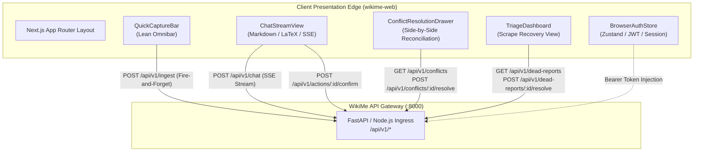
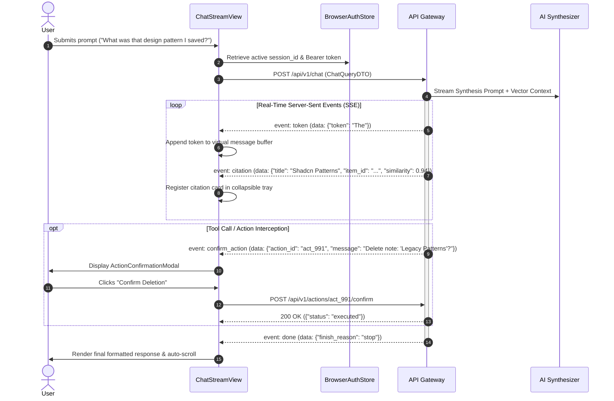
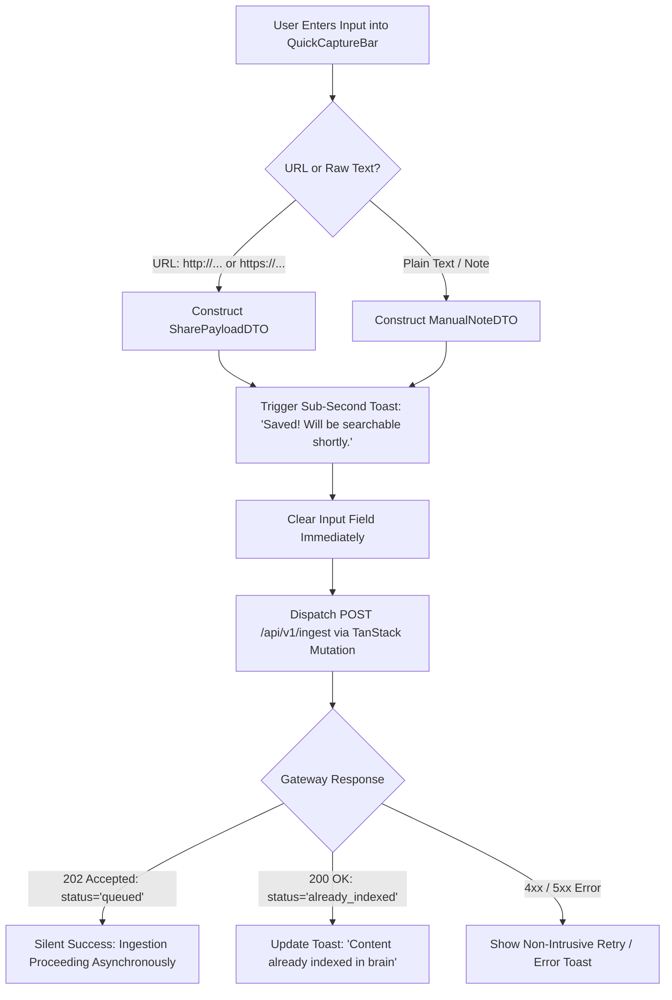
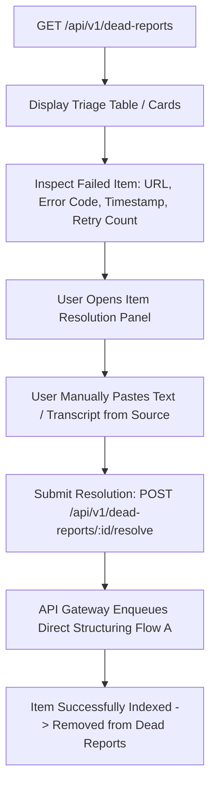

# Architecture Specification: `wikime-web`

**Presentation Edge & Web Client Architecture**

This document specifies the technical architecture, component hierarchy, data-flow sequences, and boundary constraints for `wikime-web` — the Next.js 15 client application powering the WikiMe second-brain experience.

---

## 1. High-Level Architectural Overview

`wikime-web` operates strictly at the **Presentation Edge** of the WikiMe ecosystem. It provides an ergonomic, responsive user experience across desktop and mobile browsers while delegating all computational heavy lifting, scraping, vector search, and AI synthesis to the backend services via the central API Gateway.



---

## 2. Core Component Specifications

### 2.1 Conversational Chat View (`ChatStreamView`)

`ChatStreamView` serves as the primary portal for conversational knowledge synthesis, factual memory recall, and natural-language knowledge management.



#### Key Capabilities & Implementation Details:

1. **Server-Sent Events (SSE) Token Consumption**:
   - Uses `@microsoft/fetch-event-source` or native `ReadableStream` on `fetch()` to consume `POST /api/v1/chat`.
   - Listens for discrete event channels:
     - `event: token`: Chunked textual tokens appended instantly to the message stream.
     - `event: citation`: Retrieval source provenance cards containing title, URL, chunk snippet, and similarity score.
     - `event: confirm_action` / `event: tool_call`: Triggers confirmation modal for destructive operations.
     - `event: error`: Surfaces inline error badges without tearing down conversation context.
     - `event: done`: Closes stream connection, records token metrics, and commits turn to local history.
2. **Rich Typography & Syntax Highlighting**:
   - **Markdown**: Rendered via `react-markdown` and `remark-gfm` (supporting tables, checklists, callouts).
   - **LaTeX Mathematics**: Processed through `remark-math` and `rehype-katex` to render complex formulas ($E = mc^2$, matrix algebra, vector equations).
   - **Syntax Highlighting**: Code fences parsed via `shiki` or `rehype-pretty-code` with dual light/dark theme support and copy-to-clipboard actions.
3. **Collapsible Source Citation Cards**:
   - Each cited vector document is rendered as a clean, collapsible pill or footer card at the bottom of the assistant's turn.
   - Expanding the card reveals the exact text chunk extracted from the vector store, similarity percentage, and direct link to the original URL.
4. **Tool-Call Confirmation Modals**:
   - When the AI Synthesizer determines an action requires explicit human confirmation (e.g., executing `delete_memory(search_term="...", confirmation_required=true)`), the stream yields a `confirm_action` event.
   - The UI halts passive streaming, displays an interactive modal with the proposed action details, and triggers `POST /api/v1/actions/:id/confirm` upon explicit confirmation.

---

### 2.2 Quick Capture Omnibar (`QuickCaptureBar`)

`QuickCaptureBar` provides an ultra-low-friction capture mechanism accessible from anywhere in the application.



#### Key Capabilities & Implementation Details:

1. **Fire-and-Forget Lean UX**:
   - In alignment with WikiMe's lean design principles, the user is never forced to wait for scraping, transcription, embedding, or vector indexing.
   - Upon submitting an entry, the UI produces an optimistic toast notification using `sonner` in **< 200ms**: *"Saved! Will be searchable shortly."*
   - The input composer clears immediately, enabling continuous capture.
2. **Polymorphic Ingestion DTO Dispatch**:
   - Analyzes input format: URLs trigger `SharePayloadDTO` (`content_type: "url"`), while free-form text triggers `ManualNoteDTO` (`content_type: "manual_note"`).
   - Dispatches payload asynchronously in the background via TanStack Query mutation to `POST /api/v1/ingest`.
3. **Graceful Failure Handling**:
   - If the network fails or the API Gateway returns an unrecoverable validation error, a toast badge notifies the user with a 1-click retry option without blocking current browsing.

---

### 2.3 Conflict Resolution Drawer (`ConflictResolutionDrawer`)

When incoming content exhibits high similarity or factual contradiction with existing knowledge, the backend flags the incoming item as `status: "PENDING_CONFLICT_RESOLUTION"`. The `ConflictResolutionDrawer` provides an interactive side-by-side reconciliation interface.

```mermaid
graph LR
    subgraph Trigger ["Conflict Detection"]
        Alert["Conflict Alert / Indicator Badge"]
        Fetch["GET /api/v1/conflicts"]
    end

    subgraph Drawer ["ConflictResolutionDrawer (Side-by-Side)"]
        ExistingDoc["Existing Knowledge Record<br/>- Title & Original Content<br/>- Ingested Timestamp<br/>- Source Citations"]
        IncomingDoc["Incoming Knowledge Record<br/>- New Content / Claim<br/>- Ingestion Source<br/>- Similarity Score & Type"]
    end

    subgraph Actions ["Action Resolution Policies"]
        Overwrite["OVERWRITE_OLD<br/>(Purge existing, store new)"]
        Duplicate["STORE_DUPLICATE<br/>(Store both independently)"]
        Merge["SYNTHESIZE_MERGE<br/>(AI Synthesizer merges records)"]
        Discard["DISCARD_NEW<br/>(Drop incoming, keep old)"]
    end

    Alert --> Fetch --> Drawer
    Drawer --> Actions
    Actions -->|"POST /api/v1/conflicts/:id/resolve"| Resolved["API Gateway: Status -> INDEXED"]
```



#### Conflict Categories & Thresholds:
- **Case 1: Exact Overlap ($\text{Similarity} \ge 0.98$)**: Identical or verbatim duplicate knowledge.
- **Case 2: High Partial Overlap ($0.80 \le \text{Similarity} < 0.98$)**: Evolving knowledge, updated facts, or overlapping insights.
- **Case 3: Factual Contradiction**: Opposing claims (e.g., preference reversal, conflicting technical guidelines) detected via NLI or entity assertion collision.

#### Four Action Resolution Options:
1. **`OVERWRITE_OLD`**: Purges the older conflicting record from the vector store and indexes the incoming memory.
2. **`STORE_DUPLICATE`**: Indexes the incoming memory as an independent vector record while preserving the existing memory intact.
3. **`SYNTHESIZE_MERGE`**: Invokes the AI Structurer to synthesize both records into a single consolidated knowledge entity with updated metadata.
4. **`DISCARD_NEW`**: Drops the staged incoming item completely and retains the existing memory.

---

### 2.4 Dead Reports Triage Dashboard (`TriageDashboard`)

Web scraping can fail due to paywalls, bot challenges (Cloudflare, CAPTCHAs), anti-scraping defenses, or broken URLs. In accordance with WikiMe guidelines, the system never attempts automated CAPTCHA bypasses. Instead, failed scraping jobs land in the Dead-Letter Queue with `status: "SCRAPE_FAILED"` and are surfaced in `TriageDashboard`.



#### Key Capabilities & Implementation Details:
- **Triage Listing**: Queries `GET /api/v1/dead-reports` to present all failed ingest operations filtered by authenticated user and workspace.
- **Diagnostic Details**: Displays failure metadata, including HTTP status codes (e.g., `403 Forbidden`, `429 Too Many Requests`), scraper error traces, and original submission timestamps.
- **Manual Text/Transcript Paste**: Offers an expandable text area where users can copy and paste raw article text, video transcripts, or excerpts directly from their browser.
- **Immediate Re-indexing**: Submits the pasted content via `POST /api/v1/dead-reports/:id/resolve`, immediately bypassing scraping and routing the content into the AI Structuring and Vectorization pipeline (Flow A).

---

### 2.5 Local Session & Auth Store (`BrowserAuthStore`)

`BrowserAuthStore` is a Zustand-powered client store encapsulating authentication state, token refresh lifecycles, and session routing.

#### Responsibilities:
1. **JWT & Session Management**:
   - Stores short-lived access JWT in memory to mitigate XSS exposure.
   - Supports HttpOnly refresh cookie rotation via the API Gateway.
   - Generates and persists active `session_id` in `sessionStorage` to maintain multi-turn conversational context across page refreshes.
2. **Multi-Tenant Context**:
   - Maintains active `org_id` and `workspace_id` state.
   - Automatically injects workspace contextual headers (`X-Workspace-Id`, `X-Org-Id`) into all outgoing API requests.
3. **HTTP Interceptor Integration**:
   - Intercepts all outgoing TanStack Query / Fetch requests to inject `Authorization: Bearer <JWT>`.
   - Intercepts incoming `401 Unauthorized` responses to trigger silent token refresh or redirect to login.

---

## 3. In-Scope vs. Forbidden Boundaries

To prevent architectural drift and security vulnerabilities, engineers and agents working on `wikime-web` must strictly adhere to the following boundary matrix:

```
┌────────────────────────────────────────────────────────────────────────┐
│                   wikime-web Boundary Matrix                           │
├──────────────────────────────────┬─────────────────────────────────────┤
│       IN-SCOPE (ALLOWED)         │       FORBIDDEN (PROHIBITED)        │
├──────────────────────────────────┼─────────────────────────────────────┤
│ ✓ Next.js 15 UI presentation     │ ✗ Direct PostgreSQL / DB connections│
│ ✓ Tailwind / Radix UI styling    │ ✗ Direct Redis / BullMQ connections │
│ ✓ Client-side form validation    │ ✗ Direct Qdrant / Pinecone queries  │
│ ✓ Fetching /api/v1/* endpoints   │ ✗ Local LLM / Whisper execution     │
│ ✓ SSE event stream parsing       │ ✗ Headless scraping / Playwright    │
│ ✓ Sub-second optimistic toasts   │ ✗ WebSocket polling for ingest jobs │
│ ✓ Markdown / LaTeX rendering     │ ✗ Bypassing API Gateway auth checks │
│ ✓ Browser session / JWT state    │ ✗ CAPTCHA solving / bot bypassing   │
└──────────────────────────────────┴─────────────────────────────────────┘
```

---

## 4. Cross-Reference Links

- [API Contracts & Schemas](API_CONTRACTS.md): Full schema definitions for all DTOs and endpoints referenced here.
- [Implementation Roadmap](ROADMAP.md): Step-by-step checklist for building and verifying these components.
- [Parent WikiMe Architecture](../../docs/PROGRESS.md): Architectural flow specifications (Flow A, Flow C, Flow D, Flow E, Flow F).
